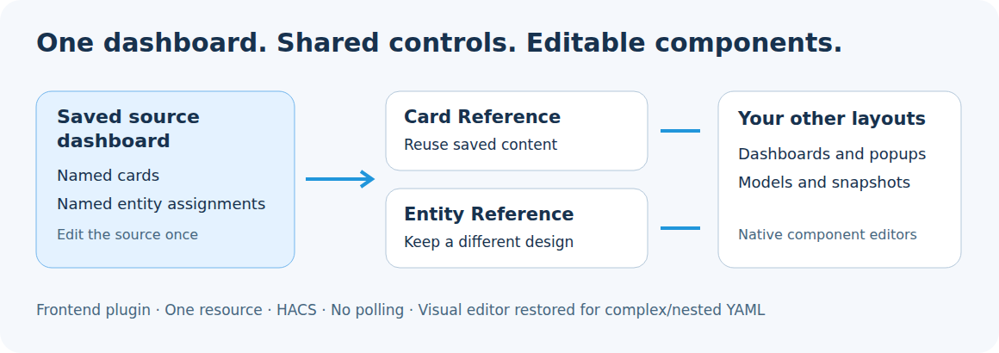

# Dashboard References

**Keep your ordinary dashboard as the source of truth—and recover access to existing visual editors when styling, wrappers, or reference metadata get in the way.**



Dashboard References is a Home Assistant **frontend dashboard plugin**, installed through HACS. One JavaScript resource includes two reference cards and two editing helpers. There is no backend integration, additional sensor, scheduled poll, or cloud service.

**Status: 0.1.0-beta.2.** This first community package derives from a working household implementation. Automated Chromium checks use a simulated Home Assistant frontend/API. A live Home Assistant 2026.10 installation, the iOS app, and every third-party card have not been certified. Start on a duplicate dashboard and report compatibility findings.

## Two reasons to use Dashboard References

### 1. Keep the dashboard you already maintain as the authority

Edit the actual garden-controls card, or replace the entity assigned to its light, and configured consumers follow that saved source. The source can remain an ordinary, useful card on your main dashboard. Whole-card references share its design; entity references let popups, guest layouts, models, and snapshots use their own designs while inheriting the same device assignments.

**The strongest distinction from UIX Foundries is where the authoritative configuration lives.** Here, it can be your existing dashboard card. UIX Foundries place reusable definitions in a separate configuration managed by UIX. Both approaches reduce repetition; this package suits people who want ordinary dashboard maintenance to remain the central workflow.

### 2. Make customized cards practical to edit visually again

A card may have a perfectly usable native visual editor until it is placed inside a stack or wrapper, decorated with `card_mod`, UIX-related configuration, or reference metadata, or embedded in a popup. The surrounding configuration can cause Home Assistant to offer only YAML editing, even though the inner card still has its own graphical editor.

**The optional editing helpers expose those existing editors without requiring you to dismantle the layout or discard its styling.** Select the inner component, edit the options its native editor supports, and keep the supported surrounding metadata and entity bindings when the component is put back.

- **Component Editor** selects individual cards inside complex configurations and preserves supported styling, layout, visibility, and reference metadata. It also recognizes the saved `element` inside a UIX Forge wrapper. **It is useful even if you use neither reference card.**
- **Reference Editor** bridges our entity-reference wrappers to the native floor3d-family and snapshot editors. Their controls receive actual entity IDs; accepted edits are converted back into stable source references.
- **Resolved YAML editing** also shows actual IDs in the card editor, while the saved configuration retains its reference tokens.

For example, you can adjust a tile's name or icon through its native visual editor while retaining its `card_mod` styling, or edit a supported model card without replacing its shared entity references with hard-coded IDs. The helpers expose existing visual controls; CSS, templates, and options the underlying editor does not support may still need YAML. UIX-specific preservation depends on the saved wrapper/configuration and is not a claim that arbitrary generated or templated UIX content has a visual editor.

## What is included?

| Feature | Purpose |
| --- | --- |
| `custom:dashboard-card-reference` | Render the saved configuration of a named source card, including cards in unopened views or another dashboard. |
| `custom:dashboard-entity-reference` | Keep a different layout while substituting named entity assignments from a source dashboard. |
| Reference Editor | Open native floor3d-family and floor3d-snapshot visual editors with actual entity IDs, then save stable references. |
| Component Editor | Select individual cards inside stacks, wrappers, tabs, and popups; retain surrounding layout metadata and styling. Show concrete entity IDs in card YAML editing while preserving reference tokens on save. |

**Reference rendering and editor recovery are independent benefits.** Disable the optional editors if you only need references; use Component Editor on existing customized cards even if you have no reference consumers. A card that has no native visual editor still uses YAML.

## Why use this?

A light may appear on a main dashboard, a room popup, a guest dashboard, a 3D model, and a snapshot. Repeating its entity ID in five places means five updates when the device is replaced. Give the authoritative dashboard entry a stable name and let the other layouts inherit that assignment.

For complete controls, reference the whole card. Edit the original card once; referencing instances use the saved configuration. Every rendered instance has its own temporary UI state, so selected tabs and expanded rows are not synchronized.

This does not rename entities, modify automations, replace Home Assistant's entity registry, or provide access control. A hidden source view and a restricted-looking guest layout are not security boundaries. Source dashboard reads and entity actions use the signed-in user's Home Assistant connection.

## Install through HACS

Repository: **`FortranFour/dashboard-references`**.

1. In HACS, open **Custom repositories** and enter `https://github.com/FortranFour/dashboard-references`, category **Dashboard**. Older HACS versions may call the category Lovelace/plugin.
2. Download Dashboard References. For this beta, select the prerelease if HACS does not offer it by default; the default branch also contains the built file.
3. Check **Settings → Dashboards → Resources**. Keep exactly one resource:

   ```yaml
   url: /hacsfiles/dashboard-references/dashboard-references.js
   type: module
   ```

4. Reload the frontend, including each mobile app/webview. Look for **Dashboard Card Reference** and **Dashboard Entity Reference** in the card picker.

HACS custom-repository installation is separate from inclusion in the default HACS catalog. This repository is packaged for custom-repository distribution; default listing requires a separate submission and review. See the [publisher requirements](https://hacs.xyz/docs/publish/plugin/).

### Manual installation

Copy `dist/dashboard-references.js` from the repository or release into `/config/www/dashboard-references.js`, then register `/local/dashboard-references.js` as a JavaScript module. Do not install `src/` as separate resources.

### Disable editing helpers

Use one of these resource URLs, then reload:

```text
/hacsfiles/dashboard-references/dashboard-references.js?editors=false
/hacsfiles/dashboard-references/dashboard-references.js?component_editor=false
```

The first keeps only runtime reference rendering. The second retains the dedicated reference editor while disabling the broad component/YAML editor adapter. Disable flags are diagnostic and deployment choices; changing them takes effect after a frontend reload. Do not register both a normal URL and a flagged URL.

## Quick start: reuse an existing card

Add a unique `card_reference_id` to the original card in a saved source dashboard:

```yaml
type: entities
title: Garden controls
card_reference_id: garden_controls
entities:
  - entity: light.garden
  - entity: switch.fountain
```

Use it in another location:

```yaml
type: custom:dashboard-card-reference
dashboard: lovelace
card_id: garden_controls
```

`dashboard` is the dashboard URL path, not a view path or display title. For `/dashboard-home/rooms`, use `dashboard-home`. The default is `lovelace`.

The original source view need not have been visited. The plugin reads saved dashboard configuration through Home Assistant's WebSocket API, rather than copying a rendered HTML element. Unsaved source edits become authoritative after you save them.

### Several sources in one card

```yaml
type: custom:dashboard-card-reference
dashboard: lovelace
card_ids:
  - garden_controls
  - energy_controls
layout: tabs
labels:
  - Garden
  - Energy
strip_heading: true
```

Tabs are included in this package and support keyboard navigation. `layout: vertical` and `layout: horizontal` use native stacks. No external tab-card package is required. `labels` follows the source order.

| Option | Default | Meaning |
| --- | --- | --- |
| `dashboard` | `lovelace` | Source dashboard URL path. |
| `card_id` | — | One source card identifier. |
| `card_ids` | — | Nonempty list of identifiers; takes precedence over `card_id`. |
| `layout` | `tabs` | Multiple-source layout: `tabs`, `vertical`, or `horizontal`. |
| `labels` | Source titles/IDs | Optional tab labels by position. |
| `strip_heading` | `false` | Remove the leading heading from each cloned source. |

Source cards and their saved metadata are not modified by rendering. Reference metadata and outer `grid_options`/`layout_options` are removed from the rendered copy; destination placement belongs on the reference card itself. Arbitrary local overrides of the source configuration are not implemented. Use Entity Reference when the destination needs a distinct design.

## Quick start: share entities across different designs

The authoritative source can be a visible existing card:

```yaml
type: entities
title: Garden controls
card_reference_id: garden_controls
entities:
  - entity: light.garden
    entity_reference_id: garden_light
  - entity: switch.fountain
    entity_reference_id: garden_fountain
```

A separate layout inherits those assignments:

```yaml
type: custom:dashboard-entity-reference
dashboard: lovelace
expected_domains:
  garden_light: light
  garden_fountain: switch
card:
  type: horizontal-stack
  cards:
    - type: tile
      entity: "[[entity:garden_light]]"
    - type: tile
      entity: "[[entity:garden_fountain]]"
```

Replace `light.garden` with `light.garden_replacement` **on the source entry**, retaining `garden_light`. Consumers resolve the new ID. `expected_domains` optionally prevents accidentally assigning a switch entity to a light-specific control. Change the destination control intentionally when changing domains.

**`[[entity:...]]` is package syntax, not native Home Assistant syntax.** Quotes are required for standalone tokens in YAML. Resolution traverses string values in `card`, including action payloads and template strings; mapping keys are not substituted. It is textual substitution, not Jinja or JavaScript evaluation.

Entity source definitions must be within a subtree marked by a `card_reference_id`. Role names must be unique across that source dashboard and use letters, numbers, dots, underscores, or hyphens. The same role may exist in another dashboard; consumers explicitly select their source dashboard.

| Option | Default | Meaning |
| --- | --- | --- |
| `dashboard` | `lovelace` | Source dashboard URL path. |
| `card` | Required | Ordinary card/stack configuration containing reference tokens. |
| `expected_domains` | `{}` | Optional mapping of role name to entity domain. |

Additional source selector forms, templates, and entity catalogs are described in [Configuration](docs/CONFIGURATION.md).

## Recovering visual editing in customized cards

The editing helpers address a separate maintenance problem: the outer configuration can make an otherwise editable inner card appear to be YAML-only. Component Editor gives you access to that inner card’s existing editor while retaining supported surrounding properties. It does not remove your styling from the saved card.

Open a card's ordinary Home Assistant edit dialog. Component Editor adds a component selector for nested configurations and preserves `card_mod`, source IDs, layout/visibility metadata, and existing entity bindings while editing the selected component.

- A supported wrapped floor3d-family or snapshot card delegates to its existing native editor. The editor sees actual IDs; configuration-change events are mapped back to source roles.
- For other components, linked bindings are protected. Replace a device at its source entry. A message explains when an attempted component edit is kept linked to the original source.
- Card YAML editing displays concrete IDs while the saved configuration remains tokenized. This applies to the card editor, **not** the dashboard-wide raw configuration editor or files on disk.
- Choosing an unregistered entity in a referenced configuration produces a missing-source error. Add a unique role on the source dashboard, save, and reopen the editor.
- Whole-card references offer **Edit source**. Direct source saving is limited to the currently open dashboard in storage mode, uses a separate **Save source card** button, and checks whether the original source changed. Cross-dashboard source edits direct you to the source dashboard. YAML-mode sources must be saved in their YAML files.

The editing helpers do not give every third-party configuration a graphical editor. Source registration and unusual native-card options may still require YAML.

## Example use cases

1. **Dashboard and popup agree.** Maintain garden controls once, then reference them inside several popup contents. Your popup provider is separate; Browser Mod is not a runtime dependency.
2. **A device replacement updates several designs.** Keep a conventional light control, a 3D object binding, and a snapshot interaction linked to one named source assignment.
3. **A compact household dashboard.** Make a simpler layout using selected roles from the main dashboard. Home Assistant permissions still govern access.
4. **One model, several views.** Store a house model once and reference it in an isolated view and a combined house/garage stack. This deduplicates configuration; each visible instance still loads and renders its own model.
5. **Recover a styled card’s visual editor.** A tile with `card_mod` or other preserved metadata may fall back to YAML in the ordinary editor. Edit the inner tile’s supported options visually while keeping its styling.
6. **Edit a deeply nested or UIX-wrapped card.** Select a tile inside a stack or a saved Forge `element`, use its existing visual editor, and retain the surrounding wrapper. This use case requires no reference cards.

See [complete dashboard example](examples/dashboard.yaml), [cross-dashboard consumer](examples/guest-dashboard.yaml), [3D binding](examples/model-binding.yaml), and [shared popup content](examples/popup-content.yaml).

## Comparison with UIX and related packages

**Compare both the authoring model and the editing workflow.** Configuration reuse overlaps substantially with UIX Foundries and Decluttering Card. Dashboard References combines an existing dashboard as the authority with helpers for accessing native editors inside customized configurations. It does not claim exclusive ownership of configuration reuse or universal visual-editor support.

| Tool | Where reusable configuration lives | Main strength | When it is a good fit |
| --- | --- | --- | --- |
| **Dashboard References** | Existing saved dashboard cards and named source entries | Reuse a maintained dashboard as authority; bridge native component editors | You want existing dashboard edits and device assignments to drive other layouts. |
| **UIX Forge / Foundries** | Named reusable configurations managed by UIX; local fragments can override shared definitions | Template-driven configuration, styling, reusable bases, and additional behaviors | You want a broader dynamic UI framework or reusable definitions independent of visible dashboard cards. |
| **Decluttering Card** | `decluttering_templates` in dashboard configuration | Repeated card patterns with variables and defaults | You want many similar instances of a named template. |
| **Config Template Card** | Configuration inside each wrapper, using JavaScript expressions and declared entities | Configuration calculated from states and variables | You want dynamic card options based on current data. |

**The authoritative source is the practical distinction:** edit the actual card you already maintain on your main dashboard, rather than maintaining a separate reusable definition for that purpose. **Editor recovery is the second benefit:** the component helper can expose existing graphical editors inside styled or wrapped configurations, even without using our reference cards. Foundries can centralize configuration and entity assignments too. Dashboard References does not replace UIX styling, sparks, or its broader templating facilities. UIX itself continues to evolve, so no blanket claim is made about absent editor features.

The component selector recognizes `custom:uix-forge` → `element`. This is a specific compatibility aid, not certification of every UIX version, foundry, template, or nested construction. Configuration generated entirely at runtime may not exist as a selectable saved component.

Primary documentation reviewed October 20, 2026:

- [UIX Forge](https://uix.lf.technology/forge/forge/) and [Foundries](https://uix.lf.technology/forge/foundries/)
- [Decluttering Card](https://github.com/custom-cards/decluttering-card)
- [Config Template Card](https://github.com/iantrich/config-template-card)

## Refresh, performance, and limits

Dashboard reads are shared per connection, concurrent lookups are deduplicated, and indexed configurations are reused. A `lovelace_updated` subscription invalidates source caches and refreshes mounted reference cards; reconnects do the same. Unchanged resolved configurations keep their child instance. Changed configurations create a new child instance, which can reset its temporary UI state or reload a 3D scene.

If update subscriptions are unavailable, reads are not retained as a persistent remote cache. Reopening/recreating a reference triggers a fresh read; there is no periodic polling. YAML-file changes may require Home Assistant's normal dashboard reload and a frontend reload. Open editor source maps are refreshed by reopening the editor.

Whole-card references **cannot contain another whole-card reference**, including one nested inside a source stack. This conservative rule prevents reference cycles. Reference original content directly, or build a destination stack of sibling references. Entity wrappers also reject nested whole-card references. Nested source IDs themselves are allowed if each ID is unique.

All underlying custom cards must be installed and their resources loaded. Source metadata on a native card may prevent its ordinary graphical editor from accepting that card directly; Component Editor temporarily removes and then restores supported metadata. Native editors can also reject unknown fields independently.

The component/YAML editor adapter hooks Home Assistant frontend internals (`hui-card-element-editor`, its YAML handler, and template output). Those are a maintenance risk across Home Assistant releases. Guards report unavailable editor support; runtime rendering can remain enabled with `?editors=false`. Current minimum target is Home Assistant 2026.10; this is not a claim of live-version certification.

See [migration notes](docs/MIGRATION.md), [troubleshooting and compatibility](docs/COMPATIBILITY.md), and [testing details](docs/TESTING.md).

## Development and release

```sh
npm ci
npx playwright install chromium
npm run build
npm run check
npm test
```

`src/runtime.js`, `src/reference-editor.js`, and `src/component-editor.js` are bundled deterministically by `scripts/build.mjs` into `dist/dashboard-references.js`. The browser package has no npm runtime dependencies. Tests use Playwright only during development.

For an unpublished checkout, `bash scripts/publish.sh` creates the new public `FortranFour/dashboard-references` repository using an authenticated GitHub CLI, sets topics, and pushes the version tag. It refuses an existing repository or origin remote.

GitHub Actions run build verification, browser checks, and HACS validation (`category: plugin`). Version tags matching `package.json` publish the built file as a GitHub prerelease after the release-job checks pass. This beta workflow deliberately marks releases as prereleases.

[MIT license](LICENSE). Originally developed for FortranFour's Home Assistant dashboards. UIX, Home Assistant, and the referenced custom-card projects are independent projects; this package does not bundle their code or imply their endorsement.
